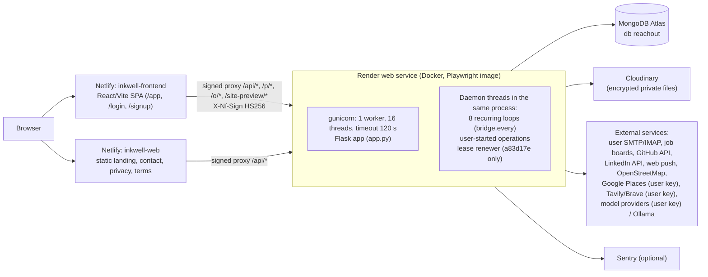

# Current system architecture

**Status:** CURRENT IMPLEMENTATION, verified in source on 2026-11-26 · **Last reviewed:** 2026-11-26

This document describes what exists. The intended agentic platform is described separately in
[TARGET_AGENTIC_ARCHITECTURE.md](TARGET_AGENTIC_ARCHITECTURE.md), and nothing in it exists yet.

## Releases referred to in this document

| Label | Commit | Where it runs | Classification |
|---|---|---|---|
| **Production** | `8b59986` (Phase 0 Step 1 fixes) | Render web service | PRODUCTION IMPLEMENTATION (deployed; smoke-tested after deploy) |
| **Local main** | `a83d17e` (7 commits ahead of `origin/main`, unpushed) | Developer Mac only | TESTED IMPLEMENTATION (419 tests pass locally) |

Where the two differ, this document says so. The main difference: in `8b59986`, locks, progress and schedules live in
process memory. In `a83d17e` they live in MongoDB (`infra/locks.py`, `infra/operations.py`, `infra/schedule.py`).

## Topology

URLs that appear in configuration comments (`frontend/netlify.toml`, `render.yaml`) and the backend README:
- app: `reachout-application.netlify.app`;
- landing: `reachout-web.netlify.app`;
- backend: `reachout-backend-1uyl.onrender.com`.

Whether these are the current production hostnames is **UNKNOWN** (Stage 0.1 inventory).

## Components

| Component | Repository | Technology | Document |
|---|---|---|---|
| API and background work | `inkwell-backend` (`backend/`) | Python, Flask 3.1.3, gunicorn 26.2.0, pymongo 4.18.2, Playwright 1.63.0, langchain-core 1.6.6 | [BACKEND_ARCHITECTURE.md](BACKEND_ARCHITECTURE.md) |
| Web app | `inkwell-frontend` (`frontend/`) | React 18.3.1, Vite 5.4.11, custom router, no test runner | [FRONTEND_ARCHITECTURE.md](FRONTEND_ARCHITECTURE.md) |
| Public site | `inkwell-web` (`web/`) | Static HTML/CSS/JS built by `netlify-build.mjs` | [FRONTEND_ARCHITECTURE.md](FRONTEND_ARCHITECTURE.md#public-site-inkwell-web-folder-web) |
| Database | — | MongoDB Atlas 8.0 in production (tier **UNKNOWN**); a local one-node replica set `rs0` for development and tests | [DATABASE_ARCHITECTURE.md](DATABASE_ARCHITECTURE.md) |
| File storage | — | Cloudinary private raw objects (Fernet-encrypted before upload); GridFS fallback | [DATABASE_ARCHITECTURE.md](DATABASE_ARCHITECTURE.md#gridfs-and-cloudinary) |

## Request path
1. The browser calls a same-origin path on a Netlify site.
2. Netlify forwards it to Render with an `X-Nf-Sign` JWT, signed with `NETLIFY_PROXY_SECRET`.
3. `core/security.py` (`only_via_netlify`, `netlify_signed`) rejects unsigned requests with 404, except `/healthz`.
4. Write requests to `/api/*` must carry `X-Requested-With: fetch` (`core/security.py`, `guard`).
5. `login_required` resolves the session cookie to a `uid` and passes `Workspace(uid)` to the handler.
6. Handlers read and write MongoDB. Data is Fernet-encrypted with `core/crypto.py:seal`.

Details: [../engineering/AUTHENTICATION_AND_RBAC.md](../engineering/AUTHENTICATION_AND_RBAC.md).

## What is *not* in the current system
Each of these is verified absent (no package, file or dependency):
- a model gateway;
- usage or cost records;
- budgets;
- kill switches;
- a task queue for agents;
- a worker service;
- LangGraph;
- Redis or Celery;
- a tool registry;
- an approvals system for agents;
- vector memory;
- an evaluation harness;
- telemetry spans or traces;
- an admin or Observatory UI;
- agents of any kind.

The AI features are deterministic pipelines, with optional single-turn model calls
([BACKEND_ARCHITECTURE.md §7](BACKEND_ARCHITECTURE.md#7-ai-and-model-calls)).

## Known limitations
- **One process.**
  - `Dockerfile` comment: "Do NOT raise --workers". That was true for `8b59986`.
  - `a83d17e` makes multiple processes safe in design and in tests. Running more than one has never been tried in
    production.
- **Background work runs inside the web process.** A deploy or crash stops it (see
  [../deployment/DEPLOYMENT_FAILURE_ANALYSIS.md](../deployment/DEPLOYMENT_FAILURE_ANALYSIS.md)).
- **Coordination latency.** About 0.6–0.8 s of database round trips per guarded write from Render (measured in
  Stage 1 benchmarks; `a83d17e` only).
- **Hosting plan unknown.** `render.yaml` says `plan: starter`, but the deployment documents describe Render Free.
  The actual plan is **UNKNOWN**.
