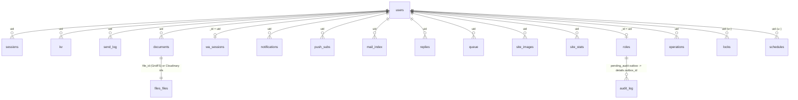

# Database architecture

**Status:**
- Current collections: CURRENT IMPLEMENTATION.
- Proposed agentic collections: PROPOSED DESIGN, not approved schemas.

**Last reviewed:** 2026-11-26

The field-by-field reference is [../engineering/DATABASE_SCHEMA_REFERENCE.md](../engineering/DATABASE_SCHEMA_REFERENCE.md).
Writes per release, for deployment purposes, are in
[../deployment/DEPLOYMENT_WRITE_PATH_INVENTORY.md](../deployment/DEPLOYMENT_WRITE_PATH_INVENTORY.md).

## Connection
- **Client** (`core/db.py`):
  `MongoClient(normalised(MONGODB_URI), serverSelectionTimeoutMS=8000, appname="reachout", tz_aware=True)`, then a
  `ping`.
  - `normalised` replaces `;` with `&` as the option separator.
  - `M.<name>` returns `db[<name>]`. `M.files` is a `GridFSBucket(bucket_name="files")`.
- **Database:** `MONGODB_DB`, default `reachout`.
- **Production:** MongoDB Atlas 8.0. The tier, backup policy and Vector Search limits are **UNKNOWN**.
- **Local:** a one-node replica set `rs0` on `127.0.0.1:27017`, from `start.command` plus `tools/local_replset.py`.
  Transactions need a replica set.

## Encryption and hashing (`core/crypto.py`)

| Function | Mechanism | Used for |
|---|---|---|
| `seal(obj)` / `unseal(blob, default, strict)` | Fernet (AES-128-CBC + HMAC) over JSON. The key is derived from `SECRET_KEY` (or `data/secret.key`). `strict=True` raises `Undecryptable` | Every user content field (`data`, `meta`, `private`, `summary`) |
| `lookup_hash(v)` | HMAC-SHA256 with a separate derived key | Deterministic lookups without storing plaintext: email, session token, message id, rate-limit key |
| File encryption | `fernet.encrypt(bytes)` before GridFS or Cloudinary | Uploaded documents, the WhatsApp profile tarball, non-Cloudinary site images |
| Audit HMAC | `_derive("inkwell-audit-v1")` (`k0`) or `AUDIT_KEYS` | Audit chain integrity, not confidentiality |

Losing `SECRET_KEY` makes all sealed data unreadable. It must be kept and backed up outside the database
([../operations/BACKUP_AND_RECOVERY.md](../operations/BACKUP_AND_RECOVERY.md)).

## Current collections (24 plus the GridFS pair: 26 in total, as counted in the write-path inventory)

| Collection | Tenant key | Content encrypted | Retention | Since |
|---|---|---|---|---|
| `users` | `_id` = uid | `data` | Until account deletion | before Phase 0 |
| `sessions` | `uid` | (token hashed) | TTL `expire_at` (30 days); idle over 7 days is deleted on read | before Phase 0 |
| `otps` | email hash in `_id` | `data` | TTL | before Phase 0 |
| `ratelimits` | hashed key | — | TTL | before Phase 0 |
| `kv` | `uid` (`_id` = `<uid>:<key>`) | `data` | Account deletion | before Phase 0; `version`/`wid` **[a83d17e]** |
| `send_log` | `uid` | `data` | Account deletion only (no TTL) | before Phase 0 |
| `documents` | `uid` | `meta` and the file | Account deletion | before Phase 0 |
| `files.files`, `files.chunks` (GridFS) | `metadata.uid` | whole file | Account deletion | before Phase 0 |
| `wa_sessions` | `_id` = uid | file | `WA_SESSION_HOURS` expiry; account deletion | before Phase 0 |
| `leads` | `uid` (portfolio leads) or none (site leads) | `data` | Manual; per-user rows go on account deletion | before Phase 0 |
| `notifications` | `uid` | `data` | TTL 90 days | before Phase 0 |
| `push_subs` | `uid` | `data` | Account deletion; dropped when the push service returns 404/410 | before Phase 0 |
| `mail_index` | `uid` | `data` | Account deletion | before Phase 0 |
| `replies` | `uid` | `data` | Account deletion | before Phase 0 |
| `queue` | `uid` | `data`, `summary` | Account deletion (queued items cancelled first) | before Phase 0 |
| `site` | slugs: `uid`; singletons (`vapid`, `linkedin`): global | `data` (singletons) | Slug rows go on account deletion | before Phase 0 |
| `site_images` | `uid` | `data` (non-Cloudinary only; Cloudinary site images are public) | Account deletion (also destroys Cloudinary images) | before Phase 0 |
| `site_stats` | `uid` | — | Account deletion | before Phase 0 |
| `search` | `uid` (assumed) | UNKNOWN | Account deletion | **UNKNOWN**: listed in `USER_COLLECTIONS` but no reader or writer found |
| `roles` | `_id` = uid | — | **Not removed on account deletion** | Step 1 (`4cb8b1d`) |
| `audit_log` | global (`actor` holds a uid) | `details` redacted (`redact.pii`) | **Never deleted** | Step 1 |
| `audit_meta` | global | — | — | Step 1 |
| `locks` | `uid` or global | — | Kept, so `fence` keeps growing; per-user rows go on account deletion | **[a83d17e]** |
| `operations` | `uid` | `private` | TTL `OPERATIONS_KEEP_DAYS` (7) after finishing | **[a83d17e]** |
| `schedules` | `uid` optional | — | TTL for `once` markers only (default 40 days) | **[a83d17e]** |

### Per-user `kv` keys
Examples found in code:
- **Core:** `recipients`, `templates`, `profile`, `settings`, `contact:<rid>`.
- **AI and applications:** `applications`, `ai_match`, `ai_answers`, `ai_reports`, `ai_keys`, `ai_model`, `ai_portals`,
  and other `ai_*` keys.
- **Integrations and sync:** `apps_sync`, `website`, `portfolio`, `jobs`, `github`, `inbox_companies`, `inbox_sync`,
  `bounces_seen`, `notify_prefs`.

The complete key list is **TO BE DEFINED** (it needs a full grep with dynamic keys resolved).

Each record is one Fernet blob of up to `KV_MAX_BYTES` (12 MB; larger returns 413).

## Relationships

## Concurrency mechanisms

| Mechanism | Where | In production? |
|---|---|---|
| Atomic single-document updates (`find_one_and_update`, `$inc`, unique indexes) | Queue claim, rate limits, OTP attempts, audit `seq` | Yes |
| In-process `threading.RLock` per account | `core/workspace.py` | **Yes (8b59986)**; replaced in a83d17e |
| Leases with server-clock expiry and fencing (`locks`) | `infra/locks.py` | No: **[a83d17e]** |
| Transactions re-checking leases (`guarded_write`, snapshot read concern, majority write concern) | `Workspace.save`, portfolio slug delete | No: **[a83d17e]** |
| Versioned compare-and-set (`version = max(prev+1, $$NOW ms)`, 128-bit `wid`) | `Workspace.update` for `templates`, `inbox_companies`, `ai_portals` | No: **[a83d17e]** |
| Shared schedule slots and `once` markers | `infra/schedule.py` | No: **[a83d17e]** |

**Compatibility rule:** once `5ba9022` or later has written, `1d544b7` and `5c21025` must never be deployed
([../deployment/DEPLOYMENT_COMPATIBILITY_MATRIX.md](../deployment/DEPLOYMENT_COMPATIBILITY_MATRIX.md)).

## Account deletion
`POST /api/account/delete` (password or email code) runs these steps:
1. cancels the user's operations;
2. runs `delete_user_data(uid)` (`core/accounts.py:180`), which:
   - sets `DELETED[uid]` so background writers stop (in-process only);
   - cancels queued sends;
   - removes GridFS and Cloudinary files;
   - deletes by `uid` from `USER_COLLECTIONS`: `kv`, `send_log`, `documents`, `notifications`, `push_subs`,
     `mail_index`, `replies`, `site_images`, `site_stats`, `leads`, `queue`, `search`, `operations`, `locks`,
     `schedules`;
   - deletes `wa_sessions`, the slug rows, `sessions` and `users`.

**Not removed:** `roles` and `audit_log`/`audit_meta` (intentionally kept as security records); `otps` and
`ratelimits` (removed by TTL).
- Whether keeping a deleted user's `roles` row is intended is a **PENDING DECISION** (D-10).
- Note that `DELETED` is per process. In a multi-process deployment, another process's background writer relies on
  the `users` row check in `Workspace.save` (`core/workspace.py`).

## GridFS and Cloudinary
- **With `CLOUDINARY_URL`:** files are uploaded to Cloudinary as private raw objects, already encrypted, in 4 MB parts
  with 3 retries.
- **Without it:** files go to GridFS.
- `python app.py move-files-to-cloudinary` migrates GridFS files to Cloudinary.

## Proposed agentic collections (PROPOSED DESIGN, not approved schemas)

These names come from the documentation brief, `inkwell-agentic-architecture.md` §6 and `phase0-checklist.md` §3.
None exists. Fields and indexes are candidates for review in Phase 1. Every user-owned document carries `uid`, and
every query includes it ([../engineering/TENANT_ISOLATION.md](../engineering/TENANT_ISOLATION.md)).

| Collection | Purpose | Ownership | Expected indexes (candidate) | Access control | Retention (TO BE DEFINED unless stated) |
|---|---|---|---|---|---|
| `tasks` | Queue and lifecycle of agent work: `task_id`, `parent_task_id`, `trace_id`, `uid`, `agent_id`, `agent_version`, goal, schema-validated input, status, priority, attempts, `lease_until`, `idempotency_key`, budget, deadline, ancestry | `uid` | `(status, priority, created)`; `idempotency_key` unique; `(uid, created desc)`; `parent_task_id` | Owner reads own; worker claims; admin reads metadata only | Proposed: keep finished tasks N days |
| `task_events` | Append-only state transitions per task (claimed, retried, paused, approved, cancelled, failed) | `uid` | `(task_id, at)`; `(uid, at desc)` | Owner; admin metadata | Same as tasks |
| `agent_runs` (proposal: `runs`) | One execution of one agent version for a task: versions used, timings, outcome, totals | `uid` | `(task_id)`; `(agent_id, started desc)`; `(uid, started desc)` | Owner; admin metadata | — |
| `agent_versions` | Immutable agent configuration: instructions, I/O schema, tool ids, model config version, limits, retry policy, `created_by`, `approved_by`, status | global | `(agent_id, version)` unique | Read: runtime; write: `admin.manage_models`, audited | Kept permanently (needed to explain old runs) |
| `model_configs` | Versioned model assignment (alias → provider/model, parameters, fallbacks), status `candidate → approved → active → retired` | global | `(config_id, version)` unique; `status` | `admin.manage_models` | Kept permanently |
| `model_usage` (proposal: `usage`) | One record per model call: trace/span ids, agent, config version, requested alias, **returned model id**, tokens in/out, cost estimate and price version, latency, status, error class, `billing` (platform/byok). No prompts | `uid` | `(day, uid)`; `(day, model_id)`; `(trace_id)`; `(agent_id, day)` | User sees own totals; admin sees all (metadata) | Long enough for monthly budgets and billing; exact period TO BE DEFINED |
| `traces` (proposal: `traces` + `spans`) | Correlated telemetry: one trace per goal, spans per model call, tool call, delegation, approval, retry, error. A redacted summary is kept separate from an encrypted payload reference | `uid` | `(trace_id, start)`; `(uid, started desc)`; `(type, start desc)`; TTL `expires_at` | Owner sees content; admin sees metadata only | TTL by retention policy, TO BE DEFINED |
| `approvals` | Pending and decided human approvals: task, action, proposed payload (encrypted), decision, decider, `decided_at`, edits | `uid` | `(uid, status, created)`; `(task_id)` | **Only the owning user decides**; admin metadata | Kept as long as the task, at least |
| `tool_registry` (proposal: `tools`/`tool_specs`) | Tool definitions: id, JSON schema, risk class (`read` / `write_internal` / `external_action` / `destructive`), timeout, idempotency rules | global | `_id` = tool_id | Write: admin, audited | Versioned, kept |
| `tool_grants` | Agent × tool × approval policy | global | `(agent_id, tool_id)` unique | Write: admin, audited | Versioned with `agent_versions` |
| `budgets` | Limits per scope: `global`, `user:<uid>`, `agent:<id>`, per task | scope | `_id` = scope | `admin.manage_budgets`, audited; users read their own | Current state; changes audited |
| `kill_switches` (checklist: `controls`) | Stop state per scope (`global` / `agent:<id>` / `user:<uid>`): state, reason, by, at | scope | `_id` = scope | `admin.control_agents`, audited | Current state; changes audited |
| `memory` (proposal: `memories`) | Working and long-term agent memory with an embedding vector; per-user scope | `uid` | `(uid, kind, updated)`; Atlas Vector Search index (tier check pending) | Owner only; user can view and delete (`/api/agents/memory` proposed) | User-controlled; TO BE DEFINED |
| `evaluation_results` (proposal: `evals`, `eval_results`) | Results per agent or model config version on eval datasets: scores, pass/fail, dataset version | global (datasets must not contain other users' content without consent) | `(subject, version, at)` | `admin.manage_models` | Kept with the versions they gate |

A LangGraph checkpointer adds its own checkpoint collections (names set by the package, **TO BE DEFINED**). They hold
user content and must follow the same `uid` scoping and protection.
