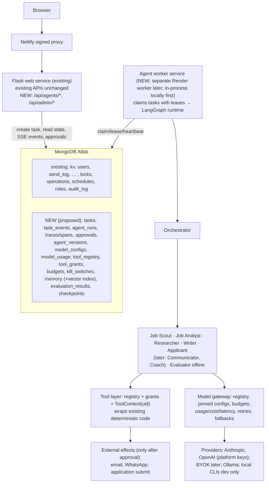

# Target agentic architecture

**Status:** APPROVED DESIGN in direction (product owner, 2026-11-25). **No component in this document exists.**
**Phase 1 implementation is not authorized.** · **Last reviewed:** 2026-11-26

Sources:
- `inkwell-agentic-architecture.md` (project root): the proposal;
- `phase0-checklist.md`: the Phase 0 plan;
- the product owner's approval message of 2026-11-25: four decisions and ten mandatory requirements, quoted in the
  ADRs.

This document turns those into one design. It doesn't add components the sources don't contain. Where it makes
something more concrete, it is labelled **PROPOSED**.

## Goal
Genuinely goal-oriented agents. In the product owner's words: "not simply an existing application with LLM calls
added to it". An agent:
- receives a goal;
- plans;
- selects authorized tools;
- executes;
- delegates to specialised agents;
- keeps its execution state;
- recovers from failures;
- asks for human approval;
- records telemetry;
- works within budgets and permissions.

Deterministic logic stays deterministic and is exposed as tools.

## Component map

| Component | Status | Design document |
|---|---|---|
| Orchestrator and specialised agents | APPROVED in direction; specs PROPOSED | [../agents/README.md](../agents/README.md) |
| LangGraph runtime and MongoDB checkpointer | APPROVED in direction ([ADR-0002](../decisions/ADR-0002-langgraph-durable-agent-runtime.md)) | [AGENT_EXECUTION_LIFECYCLE.md](AGENT_EXECUTION_LIFECYCLE.md) |
| MongoDB task queue | APPROVED in direction ([ADR-0013](../decisions/ADR-0013-mongodb-task-queue.md)) | [WORKER_AND_QUEUE_ARCHITECTURE.md](WORKER_AND_QUEUE_ARCHITECTURE.md) |
| Separate worker service | APPROVED in direction, timing undecided ([ADR-0003](../decisions/ADR-0003-separate-agent-worker.md)) | same |
| Model gateway and registry | APPROVED ([ADR-0004](../decisions/ADR-0004-platform-managed-model-keys.md), [ADR-0007](../decisions/ADR-0007-versioned-agent-and-model-configs.md)) | [MODEL_GATEWAY_ARCHITECTURE.md](MODEL_GATEWAY_ARCHITECTURE.md) |
| Tool registry, grants and `ToolContext` | APPROVED in direction | [TOOL_REGISTRY_ARCHITECTURE.md](TOOL_REGISTRY_ARCHITECTURE.md) |
| Approval, pause and resume | APPROVED ([ADR-0005](../decisions/ADR-0005-human-approval-for-external-actions.md)) | [../engineering/APPROVAL_AND_PERMISSION_MODEL.md](../engineering/APPROVAL_AND_PERMISSION_MODEL.md) |
| Memory (MongoDB, Atlas Vector Search) | APPROVED database; tier check pending ([ADR-0001](../decisions/ADR-0001-mongodb-atlas-not-postgresql.md)) | [MEMORY_ARCHITECTURE.md](MEMORY_ARCHITECTURE.md) |
| Evaluation and promotion gate | APPROVED requirement ([ADR-0007](../decisions/ADR-0007-versioned-agent-and-model-configs.md)) | [../agents/EVALUATOR_SPECIFICATION.md](../agents/EVALUATOR_SPECIFICATION.md) |
| Agent versioning | APPROVED | [ADR-0007](../decisions/ADR-0007-versioned-agent-and-model-configs.md) |
| Cost and usage tracking, budgets | APPROVED ([ADR-0008](../decisions/ADR-0008-budgets-and-execution-controls.md)) | [../operations/COST_AND_USAGE_GOVERNANCE.md](../operations/COST_AND_USAGE_GOVERNANCE.md) |
| Kill switches | APPROVED | [ADR-0008](../decisions/ADR-0008-budgets-and-execution-controls.md) |
| Telemetry and the Agent Observatory | APPROVED requirement; UI PROPOSED | [OBSERVABILITY_ARCHITECTURE.md](OBSERVABILITY_ARCHITECTURE.md) |
| Super Admin control plane (metadata only) | APPROVED ([ADR-0009](../decisions/ADR-0009-metadata-only-super-admin.md)); permission model exists | [../engineering/AUTHENTICATION_AND_RBAC.md](../engineering/AUTHENTICATION_AND_RBAC.md) |
| Shadow-mode rollout flags | APPROVED ([ADR-0010](../decisions/ADR-0010-shadow-mode-first-workflow.md)); flag storage TO BE DEFINED | [AGENT_EXECUTION_LIFECYCLE.md](AGENT_EXECUTION_LIFECYCLE.md#shadow-mode) |

## Target topology

### Separation of concerns
| Part | Responsible for |
|---|---|
| **Web** | HTTP, authentication, user data, approvals UI |
| **Worker** | Agent runtime, tools and, possibly, the recurring loops |
| **Gateway** | The only code that talks to model providers |
| **Tool layer** | The only code that touches user data or the outside world for agents |
| **Telemetry** | Append-only spans |

## Mandatory engineering requirements and where each is designed

| # | Requirement (approved 2026-11-25) | Designed in |
|---|---|---|
| 1 | Agent versioning recorded on every execution | [ADR-0007](../decisions/ADR-0007-versioned-agent-and-model-configs.md), [AGENT_EXECUTION_LIFECYCLE.md](AGENT_EXECUTION_LIFECYCLE.md) |
| 2 | Quality evaluations, regression tests, historical replay | [../agents/EVALUATOR_SPECIFICATION.md](../agents/EVALUATOR_SPECIFICATION.md) |
| 3 | Token, execution, delegation-depth and spending limits | [WORKER_AND_QUEUE_ARCHITECTURE.md](WORKER_AND_QUEUE_ARCHITECTURE.md), [../operations/COST_AND_USAGE_GOVERNANCE.md](../operations/COST_AND_USAGE_GOVERNANCE.md) |
| 4 | Tenant isolation and cross-user tests | [../engineering/TENANT_ISOLATION.md](../engineering/TENANT_ISOLATION.md) |
| 5 | Global, per-agent and per-user kill switches; controlled cancellation | [ADR-0008](../decisions/ADR-0008-budgets-and-execution-controls.md) |
| 6 | Queue reliability tests | [WORKER_AND_QUEUE_ARCHITECTURE.md](WORKER_AND_QUEUE_ARCHITECTURE.md), [../engineering/TESTING_STRATEGY.md](../engineering/TESTING_STRATEGY.md) |
| 7 | Human approval for email, WhatsApp and application submission | [../engineering/APPROVAL_AND_PERMISSION_MODEL.md](../engineering/APPROVAL_AND_PERMISSION_MODEL.md) |
| 8 | No configuration goes production-active without evaluation and approval | [ADR-0007](../decisions/ADR-0007-versioned-agent-and-model-configs.md) |
| 9 | Correlated telemetry for every model call, tool call, delegation, retry, approval, error and final output | [OBSERVABILITY_ARCHITECTURE.md](OBSERVABILITY_ARCHITECTURE.md) |
| 10 | No keys, credentials, raw database or shell for agents | [../engineering/SECURITY_AND_GOVERNANCE.md](../engineering/SECURITY_AND_GOVERNANCE.md) |

## What carries over from today
- **Reused as-is:**
  - `infra/rbac.py` (the permissions are already reserved);
  - `infra/audit.py`, `infra/redact.py`;
  - `infra/locks.py` (leases and fencing for task claims);
  - `infra/operations.py` (its state and cancellation model);
  - `infra/schedule.py`;
  - `core/crypto.py:seal` (encrypted payloads);
  - `Workspace` (user-scoped data access inside tools).
- **Wrapped as tools:** the deterministic feature code. The tool inventory is in
  [TOOL_REGISTRY_ARCHITECTURE.md](TOOL_REGISTRY_ARCHITECTURE.md).
- **Changed behind a stable interface:** `models.chat()` keeps its signature and delegates to the gateway.

## Open questions affecting the target
These are listed with IDs in [../project/PROJECT_STATUS.md](../project/PROJECT_STATUS.md#pending-decisions):
- when the worker is introduced;
- which LangGraph checkpointer package;
- how shadow flags are stored;
- the retention periods;
- the evaluation datasets;
- the Atlas Vector Search tier;
- the approval expiry period;
- whether auto-apply moves to per-action approval.
