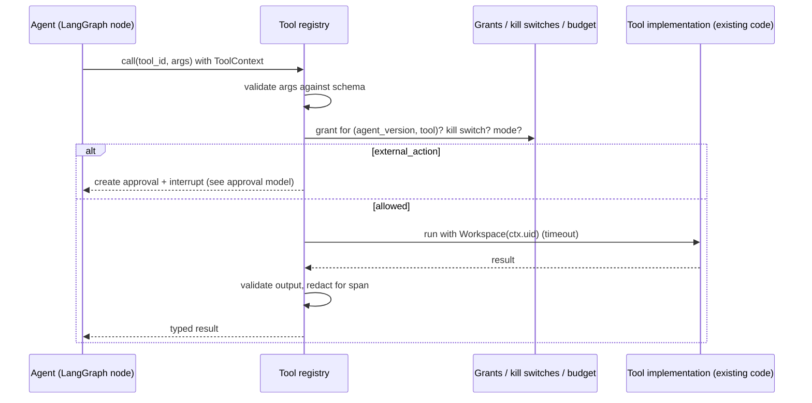

# Tool registry architecture

**Status:** APPROVED DESIGN in direction. Registry, grants and `ToolContext` are **not implemented**. The functions
listed below as tool candidates EXIST in the code today. · **Last reviewed:** 2026-11-26

## Principles (from the approved direction and requirement 10)
- Agents act only through registered tools. They get no raw database access, shell, keys or general HTTP client.
- Every tool declares:
  - an id;
  - an input and output JSON schema;
  - a risk class (`read`, `write_internal`, `external_action`, `destructive`);
  - a timeout;
  - idempotency rules.
- Every call receives a `ToolContext` built by the runtime from the task owner:
  `uid`, `trace_id`, `run_id`, `task_id`, `agent_id`, `agent_version`, `grants`, `mode` (`shadow` or `on`).
- **Grants** are agent × tool × approval policy, and they are part of the immutable agent version.
- **Every call** is checked against the grants, produces a span, and is audited when it is an `external_action`.

## Calling a tool (PROPOSED)

## Tool candidates from existing code
All the functions below were verified to exist on 2026-11-26. They are not wrapped as tools yet.

| Proposed tool | Existing function (file:line) | Risk class (proposed) | Used by |
|---|---|---|---|
| Search sources | `features/ai_jobs/sources.py:make_tools` (:154); board readers in `features/ai_jobs/boards/` (118 modules); `providers.py` (Workable, SmartRecruiters, Recruitee, remote boards) | read | Job Scout |
| Discover and fetch site jobs | `features/ai_jobs/sitejobs.py:discover` (:338), `fetch` (:390) | read | Job Scout |
| My companies | `features/ai_jobs/portals.py` | read | Job Scout |
| Nearby companies | `features/nearby.py:find_places` (:104) | read | Job Scout |
| Liveness | `features/ai_jobs/signals.py:liveness` (:57) | read | Job Scout, Analyst |
| Rank | `features/ai_jobs/ranking.py:rank` (:63) | read (pure) | Job Analyst |
| Learned preferences | `features/ai_jobs/learning.py:adjust` (:169), `taste` (:189) | read | Job Analyst |
| Evaluate (rule blocks) | `features/ai_jobs/evaluate.py` (signal and report building) | read / write_internal (report) | Job Analyst |
| Application history | `features/ai_jobs/tracker.py` | read | Job Analyst, Applicant |
| Company research | `features/research/company.py` (claim-by-claim validation), `research/public_web.py` | read | Researcher |
| Resume structure and tailoring | `features/ai_jobs/extras.py:resume_structure` (:60), `ordered` (:108); `tailor_rules.py` (accept or reject reorder-only changes); `latex.py` | write_internal (draft) | Writer |
| Cover letter | `features/ai_jobs/evaluate.py:cover_letter` (:170) | write_internal (draft) | Writer |
| Answer bank | `features/ai_jobs/answers.py` (only `approved` answers are used; drafts go to `review`) | read / write_internal (review only) | Writer, Applicant |
| Prepare application | `features/ai_jobs/apply.py:apply_url`, `apply_values`, `resume_file`, `cover_file` | read | Applicant |
| **Submit application** | `features/ai_jobs/apply.py:apply_one` (:162); `siteapply.py`; `forms.py:fill_form` (:286); `siteapply.NEVER` (:21) excludes LinkedIn, Naukri, Indeed, Glassdoor | **external_action** | Applicant |
| **Send email** | `core/sending.py` (campaign), `features/jobs.py` queue, `features/replies.py` send | **external_action** | Communicator (Phase 3) |
| Understand replies, draft a reply | `features/replies.py:understand` (:193), `draft_reply` (:656) | read / write_internal | Communicator |
| Follow-ups due | `features/ai_jobs/tracker.py:due_followups` (:144) | read | Communicator, Coach |
| Interview prep | `features/ai_jobs/extras.py:make_prep` (route :457) | write_internal | Coach |
| Learning and briefing | `features/learning/` | read | Coach |
| Notify the user | `features/notify.py:notify` | write_internal | All |
| Task and memory | `task.create/status`, `delegate(agent_id, input)`, `memory.read/write` | runtime tools (new) | Orchestrator, all |

## Notes on wrapping existing code
- Many existing functions take `ws` (a `Workspace`). A tool wrapper constructs `Workspace(ctx.uid)` and never accepts
  a uid from arguments.
- Existing functions that call `models.chat()` inside them (for example `cover_letter`, `resume_structure`,
  `research`) will reach the gateway through `chat()` once it delegates, so their usage gets recorded.
- `apply.apply_one` drives Playwright. It must run where a browser can run (memory), and only after an approval.
- In shadow mode, `write_internal` tools write to shadow records instead of user-visible state. How shadow records
  are stored is **TO BE DEFINED**.
