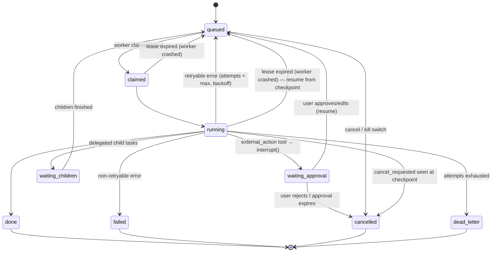

# Worker and queue architecture

**Status:**
- Current background execution: CURRENT IMPLEMENTATION.
- Task queue and worker: APPROVED DESIGN in direction, **not implemented**
  ([ADR-0003](../decisions/ADR-0003-separate-agent-worker.md), [ADR-0013](../decisions/ADR-0013-mongodb-task-queue.md)).

**Last reviewed:** 2026-11-26

## Today
- All background work runs as threads inside the web process. See
  [BACKEND_ARCHITECTURE.md §6](BACKEND_ARCHITECTURE.md#6-background-work-and-concurrency) for:
  - the 8 `bridge.every` loops;
  - user-started `operations` **[a83d17e]**;
  - 14 plain `threading.Thread` call sites.
- There is no task queue for agents. The `queue` collection is the send queue for emails and LinkedIn posts, not a
  general task queue.

## Building blocks already available **[a83d17e, local only]**

| Need | Existing mechanism | Gap for agents |
|---|---|---|
| Exclusive claim with expiry | `infra/locks.py`: atomic acquire judged by the server clock, `token`, growing `fence`, renewal thread, `guarded_write` | Per-task leases on documents in a `tasks` collection |
| Progress and states | `infra/operations.py`: `running → done/failed/cancelled/interrupted`, `public` and sealed `private` | Retry, dead-letter and pause-for-approval states |
| Cooperative cancellation | `cancel_requested` + `checkpoint()` + `Cancelled` | Kill-switch scopes; propagation to child tasks |
| Recurring work across processes | `infra/schedule.py` slots and `once` markers | — |
| External action guard | `checkpoint()` before acting; outcome recorded afterwards under the account lock | Idempotency key per action; delivery states |

## Task queue (PROPOSED DESIGN)

### Task document
From the proposal §4 and the checklist; it is a candidate schema:
`task_id`, `parent_task_id`, `trace_id`, `uid`, `agent_id`, `agent_version`, `goal`, `input` (schema-validated, with
sealed content), `status`, `priority`, `attempts`, `max_attempts`, `lease_until`, `lease_token`, `fence`,
`idempotency_key` (unique), `budget`, `deadline`, `ancestry` (list of agent ids, for cycle detection), `depth`,
`created_at`, `updated_at`.

### States

### Claim protocol
1. `find_one_and_update` on `{status: queued, run_after <= now}`, ordered by priority and creation time, which sets
   `claimed`, `lease_until = $$NOW + lease`, a new `lease_token` and `fence = max(fence+1, $$NOW ms)`. This is the
   same pattern as `infra/locks.py`.
2. **Before claiming:** kill switches (global, agent, user) and budgets are checked. A blocked task stays queued with a
   reason, or is cancelled. Which of the two is **TO BE DEFINED**.
3. **Heartbeat:** the worker renews the lease while running.
4. **Every write by the worker** matches `{task_id, lease_token}`, so a worker whose lease was lost writes nothing.
   This is the same rule as `operations`.
5. **On lease expiry,** another worker may claim the task. LangGraph resumes it from the last checkpoint.

### Limits (numbers PROPOSED, not approved)
- max delegation depth 3;
- max children per task;
- per-trace token and cost ceiling;
- deadline inherited by children;
- cycle detection through `ancestry`;
- max steps per run;
- max attempts, then `dead_letter`.

### Idempotency
- A task can carry `idempotency_key` (unique index).
- Every external action carries `hash(trace_id, tool, normalised input)`. The tool layer refuses a duplicate, so a
  retry can't send a second email or submit a second application.

## Worker (PROPOSED DESIGN)
- **Entry point:** `python -m agents.worker` (named in the proposal), from the same image as the web service, with a
  different command. It runs K concurrent runs per process and scales by adding processes.
- **Stage 1 (local development):** run the worker in-process, or as a second local process, against the local replica
  set.
- **Stage 2 (hosted):** a Render background worker. It needs:
  - its own database user (so it can be fenced);
  - its own entry in the deployment procedure (detached workers are not stopped by a web crash; see
    [../deployment/DEPLOYMENT_FAILURE_ANALYSIS.md](../deployment/DEPLOYMENT_FAILURE_ANALYSIS.md));
  - memory for Playwright.
- **Recurring loops:** they may move into the worker later. They already coordinate through `infra/schedule.py`, so
  moving them doesn't change behaviour.

## Not planned initially
- **Redis/RQ:** only if throughput requires it.
- **Celery:** not recommended.

## Acceptance tests
Required by the product owner (requirement 6); listed in [../engineering/TESTING_STRATEGY.md](../engineering/TESTING_STRATEGY.md#agent-testing-plan-proposed-structure-requirements-approved).
