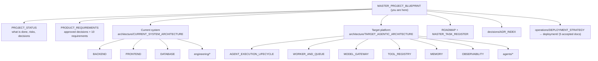

# Inkwell master project blueprint

**Status:** Entry point of the documentation system. Draft for product-owner review. · **Last reviewed:** 2026-11-26

## What Inkwell is
- **Today:** a working outreach and job-search application. Flask API on Render, React app and static site on
  Netlify, MongoDB Atlas.
- **Built so far toward the agentic platform:** a security foundation (roles, audit, redaction) that is in production,
  and a cross-process coordination layer that is tested locally but not deployed.
- **The goal:** a production-grade agentic platform whose first workflow is **Find and Prepare Applications**. **No
  agent exists yet, and building one is not authorized yet.**

## How to read this documentation

| If you want to… | Read |
|---|---|
| Know the state of the project in five minutes | [PROJECT_STATUS.md](PROJECT_STATUS.md) |
| Understand the running application | [CURRENT_SYSTEM_ARCHITECTURE.md](../architecture/CURRENT_SYSTEM_ARCHITECTURE.md), then [BACKEND](../architecture/BACKEND_ARCHITECTURE.md), [FRONTEND](../architecture/FRONTEND_ARCHITECTURE.md), [DATABASE](../architecture/DATABASE_ARCHITECTURE.md) |
| Set up a development machine and run the tests | [DEVELOPMENT_SETUP.md](../engineering/DEVELOPMENT_SETUP.md), [TESTING_STRATEGY.md](../engineering/TESTING_STRATEGY.md) |
| Look up an endpoint or a collection | [API_DOCUMENTATION.md](../engineering/API_DOCUMENTATION.md), [DATABASE_SCHEMA_REFERENCE.md](../engineering/DATABASE_SCHEMA_REFERENCE.md) |
| Understand the security model | [SECURITY_AND_GOVERNANCE.md](../engineering/SECURITY_AND_GOVERNANCE.md), [AUTHENTICATION_AND_RBAC.md](../engineering/AUTHENTICATION_AND_RBAC.md), [TENANT_ISOLATION.md](../engineering/TENANT_ISOLATION.md), [APPROVAL_AND_PERMISSION_MODEL.md](../engineering/APPROVAL_AND_PERMISSION_MODEL.md) |
| Build the agent platform (once authorized) | [TARGET_AGENTIC_ARCHITECTURE.md](../architecture/TARGET_AGENTIC_ARCHITECTURE.md), [AGENT_EXECUTION_LIFECYCLE.md](../architecture/AGENT_EXECUTION_LIFECYCLE.md), [agents/](../agents/README.md), [ROADMAP.md](ROADMAP.md) |
| Deploy anything | [DEPLOYMENT_STRATEGY.md](../operations/DEPLOYMENT_STRATEGY.md), then the [five accepted documents](../deployment/). **Nothing may be deployed outside them** |
| Know why something was decided | [ADR_INDEX.md](../decisions/ADR_INDEX.md) |
| Know what a term means | [GLOSSARY.md](GLOSSARY.md) |

## Classification used in every document

| Label | Meaning |
|---|---|
| CURRENT IMPLEMENTATION | Exists in source code |
| TESTED IMPLEMENTATION | Also verified by automated tests |
| PRODUCTION IMPLEMENTATION | Deployed and verified in production (here, `8b59986`, smoke-tested) |
| APPROVED DESIGN | Explicitly agreed by the product owner, not implemented |
| PROPOSED DESIGN | Suggested, not approved |
| PENDING DECISION | Needs the product owner ([PROJECT_STATUS.md](PROJECT_STATUS.md#pending-decisions)) |
| BLOCKED | Can't proceed until a named dependency is resolved |
| UNKNOWN / TO BE DEFINED | Not verifiable from the available evidence, or not yet designed |
| **[a83d17e]** | Exists in the local candidate release only, not in production |

## The state of things, in one table

| Area | State |
|---|---|
| Production release | `8b59986` |
| Local candidate | `a83d17e`, 7 commits ahead, unpushed; 419 tests pass |
| Phase 0 | Steps 1–3 built; 4–7 deferred into Phase 1 |
| Phases 1–4 | Not started; Phase 1 not authorized |
| Deployment procedure | Documented and accepted; not approved to execute; first migration **BLOCKED** at Stage 0.5 |
| Biggest immediate risks | Work only on one machine (OPS-01); local `.env` points at production (SEC-02) |

## Sources of truth
1. **Code and git history:** what exists. Wins over any document.
2. **The product owner's approvals:** what is decided.
   - 2026-11-25: direction, four decisions and ten requirements.
   - 2026-11-26: the deployment documents accepted, and the approval boundaries.
3. **The five deployment documents:** how deploys must happen. Authoritative and unchanged.
4. **`inkwell-agentic-architecture.md` and `phase0-checklist.md`:** the original proposal and plan, outside git in
   the project root. This documentation supersedes them as the reference. They're kept for history, and where they
   disagree with the code, the code wins (inconsistencies are listed in
   [PROJECT_STATUS.md](PROJECT_STATUS.md#inconsistencies-found)).
5. **Older design notes, still valid:** [../audit-anchoring.md](../audit-anchoring.md) and
   [../locks-progress-cancellation.md](../locks-progress-cancellation.md).

## Keeping this documentation correct
- Update the document **in the same change** as the code it describes. Update the *Last reviewed* date.
- Never move an item from PROPOSED or APPROVED to CURRENT without a commit that implements it and a test that covers
  it.
- New decisions get an ADR. New work gets a task ID in the register.
- Don't edit `docs/deployment/` except through an explicit, approved documentation revision.
