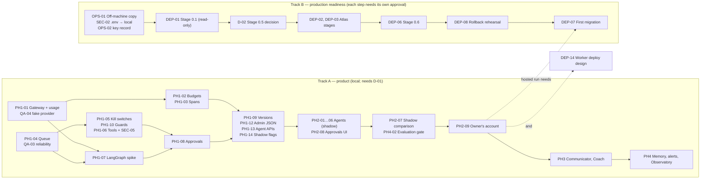

# Roadmap

**Status:** PROPOSED sequencing. The phases come from the approved direction; the ordering of tasks and the two-track
structure are proposals. Nothing in Track A is authorized yet (D-01). No dates are given. · **Last reviewed:** 2026-11-26

Task IDs refer to [MASTER_TASK_REGISTER.md](MASTER_TASK_REGISTER.md).

## Phases (from `inkwell-agentic-architecture.md` §12, §15)

| Phase | Objective | State | Proposal's own solo estimate (unvalidated) |
|---|---|---|---|
| 0 Foundations | Make Inkwell safe to run agents in a separate worker: shared state, gateway, roles, budgets, kill switches, queue, telemetry | Steps 1–3 built (Step 1 deployed); steps 4–7 deferred into Phase 1 | 1–2 weeks (already exceeded) |
| 1 Agent infrastructure | Queue, worker, LangGraph runtime, tool registry, grants, approvals, spans, gateway, budgets, kill switches, minimal Observatory | Not started; not authorized | 3–4 weeks |
| 2 First workflow | Find and Prepare Applications: shadow, then the owner's account | Not started | 2–3 weeks |
| 3 Additional agents | Communicator, Researcher (expanded), Coach | Not started | 3–5 weeks |
| 4 Intelligence and governance | Memory, Evaluator, alerts, full admin | Not started | 3–4 weeks |

## Two tracks
The product can be built locally without the production migration. Production readiness runs in parallel and joins
the product only when something is ready to ship.

## Track A: product

| Order | Tasks | Objective | Deliverable | Depends on | Acceptance | Parallel? |
|---|---|---|---|---|---|---|
| A-1 | PH1-01, QA-04 | One gateway for all model calls, with usage | `gateway` package, `model_usage`, adapters, fake provider | D-01, D-05 | Existing callers unchanged; usage recorded | With A-2 |
| A-2 | PH1-04, QA-03 | Reliable task queue | `tasks`, `task_events`, claim and lease | D-01 | Requirement 6 suite passes | With A-1 |
| A-3 | PH1-02, PH1-03 | Budgets and spans | `budgets`, `traces`/`spans` | A-1 | Refusals per scope; correlated spans | After A-1 |
| A-4 | PH1-05, PH1-10, PH1-06, SEC-05 | Controls, guards, tools, isolation | `kill_switches`, guards, registry, `ToolContext`, isolation tests | A-2 | Tests pass | After A-2 |
| A-5 | PH1-07 | LangGraph spike (for example, the Job Analyst only, in shadow) | Runtime and checkpointer decision | A-1, A-2 | Checkpoint and resume after a kill | After A-1, A-2 |
| A-6 | PH1-08 | Approvals | `approvals`, interrupt and resume | A-4, A-5 | No external action without approval | — |
| A-7 | PH1-09, PH1-11–14 | Versions, worker, admin JSON, agent APIs, shadow flags | — | A-3, A-6 | Version fields on every run; metadata-only admin | Partly parallel |
| A-8 | PH2-01…06, PH2-08 | The six agents, in shadow mode | Agents, approvals UI | A-7 | Each spec's §18 | Agents in parallel |
| A-9 | PH2-07, PH4-02 (gate) | Compare with the existing pipeline; evaluation gate | Comparison report; `evaluation_results` | A-8, D-09 | Workflow acceptance criteria | — |
| A-10 | PH2-09 | Turn on for the owner's account | Flag | A-9, and a hosted deploy (Track B) if it runs hosted | Owner's acceptance | — |

**Critical path (Track A):** A-1/A-2 → A-4/A-5 → A-6 → A-7 → A-8 → A-9 → A-10.

## Track B: production readiness

| Order | Tasks | Objective | Deliverable | Depends on | Acceptance | Parallel? |
|---|---|---|---|---|---|---|
| B-0 | OPS-01, SEC-02, OPS-02 | Remove the immediate risks | Off-machine copy; `.env` on local; key record | D-04 | Each confirmed | Yes, with everything |
| B-1 | DEP-01 | Know the real environment | Stage 0.1 record (Render plan, Atlas tier, users, triggers, backups, SMTP) | Approval | Recorded | Yes |
| B-2 | D-02 | Decide the Stage 0.5 path | Decision recorded | B-1 | — | — |
| B-3 | DEP-02, DEP-03, DEP-04 | Atlas fence and privilege stages | Stage results | Approval, B-1 | As defined in the runbook | Yes, with Track A |
| B-4 | DEP-06, DEP-08 | Fenced restart; rollback rehearsal | Stage 0.6 result; rehearsal | B-2, B-3 | As defined | — |
| B-5 | DEP-07 | First migration (possibly together with Phase 1 code, D-03) | Production on the new release | B-4 | Runbook Step 1 | — |

**Critical path (Track B):** B-1 → B-2 → B-3 → B-4 → B-5. B-2 depends on a product-owner decision, and possibly on
evidence from Render.

## What is not a prerequisite for Track A (local development)
- All of Stage 0.
- The first migration.
- Gate Stages 1–5.
- The fence harness.

They matter only for shipping. Track A depends on D-01 (authorization) and D-05 (models and budgets).
